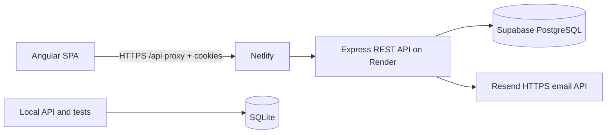
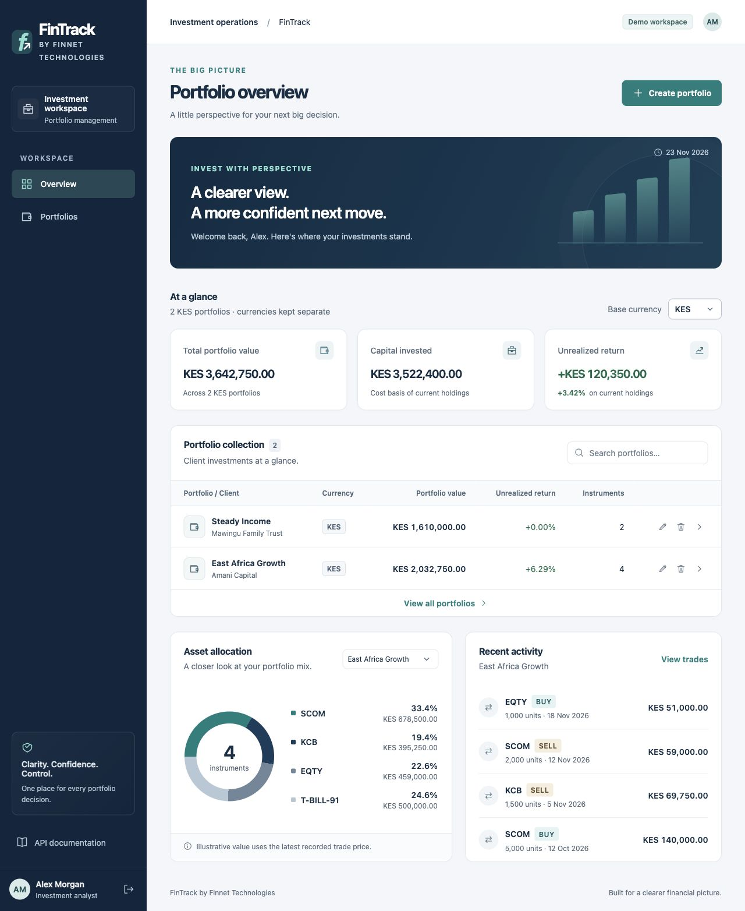
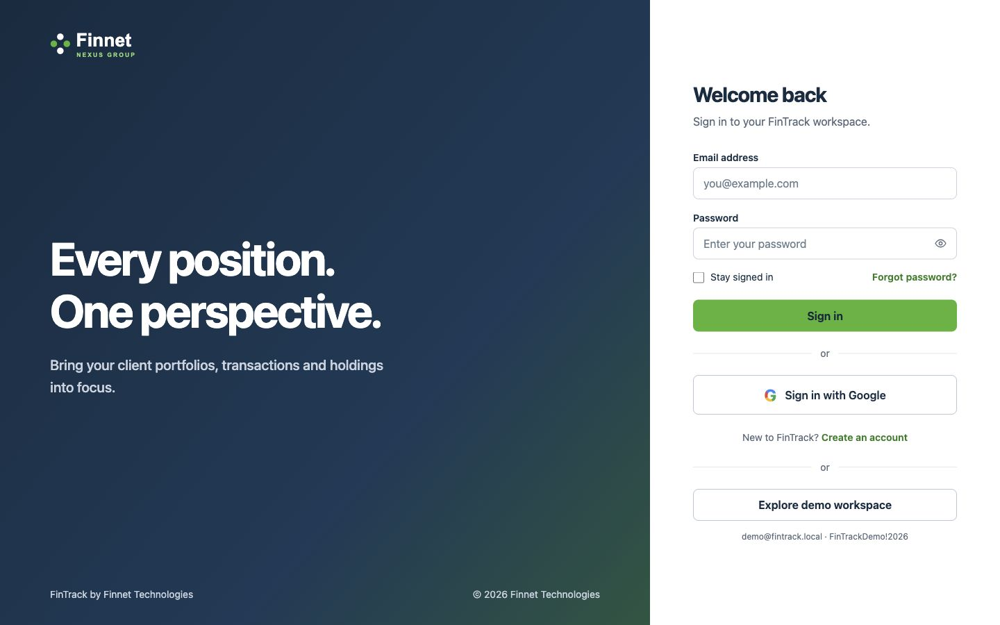

# FinTrack by Finnet Technologies

A branded portfolio and transactions workspace for a fictional investment operations team. Analysts manage client portfolios, record BUY/SELL trades, and inspect holdings, cost basis and indicative returns. Angular consumes the Express API over HTTP/JSON; all portfolio and transaction data comes from the database.

## Live application and review links

| Item | URL / value |
| --- | --- |
| Frontend | https://finnet-nexus.netlify.app/ |
| Backend | https://finnet.onrender.com/health |
| Swagger | https://finnet.onrender.com/api/v1/docs/ |
| OpenAPI JSON | https://finnet.onrender.com/api/v1/openapi.json |
| Repository | https://github.com/mwaura69/finnet |
| Merged feature PR | https://github.com/mwaura69/finnet/pull/4 |
| Demo login | `demo@fintrack.local` / `FinTrackDemo!2026` |
| Approximate effort | 14 hours, supplied by the candidate |

The deployed demo was checked over HTTPS and returned three sample portfolios. The Supabase adapter in this revision requires deployment with `DATABASE_URL`; `/health` reports `database: "postgres"` once active. See [verification](docs/VERIFICATION.md) and the [assessment checklist](docs/ASSESSMENT_CHECKLIST.md) for evidence and remaining external checks.

## Run locally in under 10 minutes

Prerequisites: Node **24.x** and npm. No hosted database or email provider is needed locally.

```sh
npm ci
cp backend/.env.example backend/.env
npm run setup
npm run dev
```

Copy the example only if you do not already have a `.env`. Open http://localhost:4200 and use **Explore demo workspace**. Local API documentation is http://localhost:3000/api/v1/docs/. The seed creates a verified demo account, three portfolios and BUYs plus partial SELLs. It preserves existing accounts, passwords and edits when repeated.

Local persistence defaults to SQLite in `backend/data/fintrack.sqlite`. With `MAIL_DELIVERY=outbox`, new-account confirmation/reset links and MFA codes are private JSON files in `backend/data/outbox`; they are not sent to an inbox. Set provider credentials only in your ignored `.env` or hosting dashboard.

## Build and run with Docker

Install Docker Desktop (or Docker Engine with the Compose plugin) and start the Docker daemon. Run every command below **from the repository root**, where `compose.yaml` is located. Stop any local servers already using ports 3000 or 8080. A host installation of Node/npm is not required for Docker: the images build the application inside Node 24 containers.

### Option 1: start the full stack with Compose

```sh
# Check the configuration and build both application images.
docker compose config --quiet
docker compose build

# Start the seed job, backend API and frontend in the background.
docker compose up -d

# Check containers and follow application logs.
docker compose ps -a
docker compose logs -f api web
```

Alternatively, build and start in one command:

```sh
docker compose up --build -d
```

The seed job is expected to finish with exit code 0. The API starts after seeding, and the frontend starts after the API health check passes. SQLite data lives in a named Docker volume, so container replacement does not remove it.

| Service | Local URL |
| --- | --- |
| Frontend | http://localhost:8080 |
| Backend health | http://localhost:3000/health |
| Swagger | http://localhost:3000/api/v1/docs/ |
| Swagger through frontend proxy | http://localhost:8080/api/v1/docs/ |

Sign in with `demo@fintrack.local` / `FinTrackDemo!2026`. Compose uses development settings and a private email outbox; it does not require Supabase or send real emails by default.

```sh
# Rebuild and start after changing application code.
docker compose up --build -d

# Restart just the running application services.
docker compose restart api web

# Stop and remove the containers/network; retain the database volume.
docker compose down
```

### Option 2: build and run backend/frontend separately

Use this instead of Compose when you want to manage each container yourself. Both builds use `.` as their context because the Dockerfiles need the root workspace lockfile and both package manifests. Keep the backend container name `api`: the frontend nginx configuration uses `api:3000` on the shared network.

```sh
# Build each image from the repository root.
docker build -f backend/Dockerfile -t fintrack-backend:local .
docker build -f Frontend/Dockerfile -t fintrack-frontend:local .

# Create a shared network and persistent database volume once.
docker network create fintrack-network
docker volume create fintrack-data
```

Start the backend first:

```sh
docker run -d \
  --name api \
  --network fintrack-network \
  -p 127.0.0.1:3000:3000 \
  --mount type=volume,source=fintrack-data,target=/app/backend/data \
  -e NODE_ENV=development \
  -e DEMO_MODE=false \
  -e SEED_DEMO_ON_START=true \
  -e PORT=3000 \
  -e DATABASE_PATH=/app/backend/data/fintrack.sqlite \
  -e FRONTEND_ORIGIN=http://localhost:8080 \
  -e MAIL_DELIVERY=outbox \
  fintrack-backend:local

# Wait until this returns a healthy response before starting the frontend.
curl --fail http://localhost:3000/health
docker logs -f api
```

`SEED_DEMO_ON_START=true` creates the missing demo account and sample records in the mounted volume. Repeated starts preserve existing credentials and data. Press Ctrl+C to leave log-following; the detached container keeps running.

Start the frontend, which serves the compiled Angular app through nginx and proxies `/api` to the backend:

```sh
docker run -d \
  --name fintrack-web \
  --network fintrack-network \
  -p 127.0.0.1:8080:80 \
  fintrack-frontend:local

# Inspect the frontend logs.
docker logs -f fintrack-web
```

Open http://localhost:8080. This manual example uses the same URLs and demo credentials as Compose, but a separate named volume from Compose's project-prefixed volume.

```sh
# Stop the manual containers.
docker stop fintrack-web api

# Start those existing containers again (backend first).
docker start api
# Wait for backend health, then:
docker start fintrack-web

# Remove stopped containers and their network; retain fintrack-data.
docker stop fintrack-web api
docker rm fintrack-web api
docker network rm fintrack-network
```

For Supabase instead of local SQLite, put the private `DATABASE_URL` in an ignored Docker environment file and add `--env-file /private/path/backend-docker.env` to the backend `docker run` command. PostgreSQL takes precedence over `DATABASE_PATH`; do not put the connection string in an image, frontend build, or README. These examples use HTTP development settings; public HTTPS deployments require the production secrets, exact origin and email settings in the [deployment guide](docs/DEPLOYMENT.md).

## Architecture, stack and rationale



- **Angular 21 / TypeScript:** typed HTTP contracts, route guards, shared forms/dialogs and signal-based state. CSS variables centralize Finnet navy, green, neutrals and spacing.
- **Express 5 / Node 24:** a small REST boundary with explicit validation, authentication, error handling and request IDs. Feature folders separate routes, controllers, services and repositories.
- **Zod:** authoritative request validation and environment checks. Inputs are normalized on the server as well as the client.
- **PostgreSQL via node-postgres:** persistent Supabase storage, parameterized queries and serializable transactions on one leased pool connection, with bounded retries for serialization conflicts. **SQLite** keeps local startup simple. Both share the same asynchronous service interface.
- **PGlite in tests:** executes the PostgreSQL schema and API flows locally without cloud credentials. Separate driver tests verify leased-client transactions, rollback and retries; hosted Supabase is verified separately after deployment.
- **Authentication:** bcrypt password hashes; short-lived JWT access cookies and rotating refresh cookies, signed CSRF tokens, server-side revocation and idle/absolute expiry. Credentials are never returned as a frontend Bearer token.
- **Resend:** HTTPS delivery works on Render Free, where SMTP ports are blocked. Durable transaction notifications are queued atomically with ledger writes and retried by a worker.

Directories: [`backend/src`](backend/src), [`Frontend/src/app`](Frontend/src/app), [`backend/src/db/migrations`](backend/src/db/migrations), [`backend/postman`](backend/postman), [`docs`](docs).

## API overview

Canonical prefix: `/api/v1`. The brief's `/api` prefix remains an equivalent compatibility alias. Portfolio, transaction, summary and profile endpoints require authentication.

| Method | Endpoint | Behavior |
| --- | --- | --- |
| POST | `/auth/register`, `/auth/login` | Register/confirm an analyst; establish cookie session |
| GET / POST | `/portfolios` | List accessible portfolios / create portfolio |
| GET / PUT / DELETE | `/portfolios/{id}` | Read, update or delete owned portfolio |
| GET / POST | `/portfolios/{id}/transactions` | List ledger / record validated trade |
| DELETE | `/transactions/{id}` | Delete trade if later sells remain valid |
| GET | `/portfolios/{id}/summary` | Net quantity, average cost, invested basis, value and returns |
| GET | `/transactions/{id}/receipt` | Printable frontend receipt data |
| GET | `/portfolios/{id}/transactions/export.xlsx` | Filtered Excel workbook |

Success responses use `{ "data": ... }`; deletes return 204. Errors use `{ "error": { "code", "message", "details?", "requestId?" } }`. Malformed JSON returns 400; invalid fields/oversells return 422; missing or inaccessible portfolios return 404; unsafe BUY deletion returns 409; missing/expired authentication returns 401.

Get `/auth/csrf` first and retain cookies. Every mutation sends `X-CSRF-Token`. Complete request bodies and additional account/member endpoints are in [OpenAPI](backend/openapi.json) and the [Postman collection](backend/postman/FinTrack.postman_collection.json).

### Postman downloads

The collection and environments are committed under [`backend/postman`](backend/postman/README.md). Download the JSON files and import them into Postman:

- [Collection JSON](https://raw.githubusercontent.com/mwaura69/finnet/main/backend/postman/FinTrack.postman_collection.json)
- [Render environment JSON](https://raw.githubusercontent.com/mwaura69/finnet/main/backend/postman/FinTrack.Render.postman_environment.json)
- [Localhost environment JSON](https://raw.githubusercontent.com/mwaura69/finnet/main/backend/postman/FinTrack.Local.postman_environment.json)

Set your email/password locally after importing; credentials and token values are blank in Git. Keep Postman's cookie jar enabled.

## Interface and screenshots

The UI includes login/registration, account verification/recovery/MFA, searchable portfolio CRUD, sortable/filterable and paginated transactions, holdings/allocation chart, live trade totals, profile/preferences, first-use tutorial, CSV/Excel export and printable receipts. Loading, empty and error states accompany API calls. Native dialogs and radios support keyboard interaction; hidden mobile navigation is inert. Amounts identify KES/USD, numeric columns align right, and return colors accompany explicit signs.

Representative screenshots captured during development; later account-flow refinements may not appear in them:

| Desktop overview | Sign in |
| --- | --- |
|  |  |

[Portfolio detail](docs/screenshots/detail-desktop.jpg) · [375px portfolio detail](docs/screenshots/detail-mobile.jpg) · [Mobile registration](docs/screenshots/register-mobile.jpg) · [Account menu](docs/screenshots/account-menu-desktop.jpg)

## Tests and CI

```sh
npm run lint
npm run build
npm test
npm run test:postgres -w backend
# All checks above:
npm run check
```

Backend integration tests use isolated in-memory databases and captured emails. They cover account confirmation, cookie/CSRF authentication, MFA/recovery, refresh reuse, role/entity authorization, ownership isolation, moving-average summaries, concurrent oversell rejection, locked currency, cascade deletion, exports, receipts, seed idempotence and provider failures. PostgreSQL-compatible tests execute the PostgreSQL schema with PGlite. Frontend tests compile Angular and exercise real components, Google terms/MFA behavior, validation, formatting and CSV escaping.

[GitHub Actions](.github/workflows/ci.yml) runs lint, builds, both database suites and frontend tests on pull requests and main/feature-branch pushes. [Verification details](docs/VERIFICATION.md).

## Assumptions and trade-offs

- Only fictional client data is used. KES and USD are kept separate; there is no FX conversion.
- Valuation uses the latest recorded trade price, not a live market feed. Invested basis is moving-average cost of open holdings, not lifetime cash deposited. Realized gains are separate.
- The complete ledger is replayed in trade-date order; creation order breaks same-day ties. Backdated trades must keep all later SELLs covered. Deleting a supporting BUY returns 409. There is no edit-trade endpoint: delete and re-add subject to these rules.
- Prices use integer minor units in storage. Quantity and calculations use JavaScript numbers with boundary checks and display rounding; a stricter accounting product should use fixed-decimal arithmetic throughout.
- Transactions are fully loaded for frontend filtering/sorting/pagination. Excel accepts server-side filters. Server pagination is a next step for large ledgers.
- Cookie auth uses a same-origin Netlify API proxy. MFA/Google/email are additional features and require functioning providers. Resend acceptance does not guarantee inbox delivery.
- SQLite files on Render Free are ephemeral. Set a backend-only Supabase `DATABASE_URL` for retained data; existing SQLite data is not silently copied. [Migration guide](docs/DEPLOYMENT.md#preserving-existing-sqlite-data).
- PWA caches the public shell only, never financial/API responses. Full offline editing is not implemented. Dark mode is optional and not implemented.

## Deployment and submission

[Deployment steps](docs/DEPLOYMENT.md) cover Render, Supabase, Netlify proxying, secrets, CORS, email, demo initialization and live smoke checks. [Git practice](docs/GIT_WORKFLOW.md), [account security](docs/SECURITY_AND_ACCOUNT_FLOWS.md), [requirement mapping](docs/ASSESSMENT_CHECKLIST.md), and a [submission email draft](docs/SUBMISSION_EMAIL.txt) are included.


**AI disclosure:** OpenAI Codex assisted with architecture, implementation, visual assets, testing, debugging and documentation. No production-grade security certification, formal WCAG certification or unobserved deployment success is claimed.
